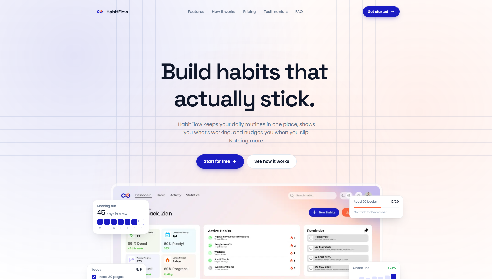

# HabitFlow Landing Page



A high performance, animation rich marketing landing page for **HabitFlow**, a habit tracker app. Built with Next.js App Router, GSAP, and smooth scrolling interactions a single page site with a hero, feature tours, pricing, testimonials, and FAQ.

## Tech Stack

| Layer | Choice |
|---|---|
| Framework | Next.js 16 (App Router) + React 19 |
| Language | TypeScript 5 |
| Styling | CSS Modules of globals + scoped `<style>` blocks (CSS variables theme) |
| Fonts | Poppins (body) & Space Grotesk (headings) via `next/font/google` |
| Animation | GSAP 3 (ScrollTrigger, SplitText), Lenis smooth scroll |
| Compiler | React Compiler enabled |

## Landing Page Sections

Scroll through a single page (`/`) composed of:

- **Navbar** fixed pill nav with scroll aware shrink, blur, and active link highlighting
- **Hero** headline, CTAs, dashboard mockup with mouse driven 3D tilt and floating stat cards
- **TrustBar** infinite logo marquee that reacts to scroll velocity
- **Features** 6 animated feature cards (streaks, check ins, charts, goals, reminders, challenges) with pinned horizontal scroll on desktop
- **ProductPreview** browser style app mockup with parallax and Heatmap/Trends highlights
- **ScrollText** oversized scrubbed marquee typography
- **WhyUs** animated count up statistics (90%, 3.5M check ins, 10K+ users, 4.9★)
- **HowItWorks** 3 pinned steps with a progress line
- **Pricing** Free / Pro / Team plans with monthly–yearly toggle
- **Testimonials** auto advancing tabbed quotes with keyboard navigation
- **Integrations** grayscale to color app logo grid
- **FAQ** accessible accordion
- **FinalCTA** dark call to action with an interactive habit chip picker
- **Footer** newsletter form, link columns, back to top

## Notable Features

- **GSAP ScrollTrigger** animations throughout: pinned sections, scrubbed marquees, masked `SplitText` heading reveals
- **Lenis smooth scrolling** synced with GSAP's ticker, including parallax background orbs
- **Preloader** with layered curtain wipe on first load
- **Magnetic buttons** and mouse tilt 3D hero mockup
- **`prefers reduced motion`** respected desktop effects are disabled and replaced with simple fades on mobile/reduced motion devices
- **Performance minded**: below the fold sections lazy loaded with `next/dynamic`, optimized images via `next/image`
- **Keyboard & ARIA support**: tab lists, accordions, and focus visible states

## Available Scripts

| Script | Description |
|---|---|
| `npm run dev` | Start dev server with Turbopack |
| `npm run dev:webpack` | Start dev server with Webpack (fallback) |
| `npm run build` | Production build |
| `npm run start` | Serve the production build |
| `npm run lint` | Run ESLint |

Open [http://localhost:3000](http://localhost:3000) to view the page.

## Project Structure

```
src/app/
├── layout.tsx          
├── page.tsx            
├── globals.css         
├── lib/
│   └── gsap-register.ts
└── components/
    ├── Navbar.tsx      ├── Hero.tsx          ├── TrustBar.tsx
    ├── Features.tsx    ├── ProductPreview.tsx├── ScrollText.tsx
    ├── WhyUs.tsx       ├── HowItWorks.tsx    ├── Pricing.tsx
    ├── Testimonials.tsx├── Integrations.tsx  ├── FAQ.tsx
    ├── FinalCTA.tsx    ├── Footer.tsx        ├── Preloader.tsx
    ├── SmoothScroll.tsx├── Protection.tsx    ├── Magnetic.tsx
    ├── SplitHeading.tsx└── Icons.tsx
```

## Design Theme

- **Brand indigo** `#1b1cc2` · **Accent orange** `#fd643b` · **Dark navy** `#0c0d2b` (CTA/footer)
- White canvas with a fixed 50px grid pattern and soft radial gradient glows
- Pill shaped buttons, large rounded cards, layered soft shadows

## Learn More

- [Next.js Documentation](https://nextjs.org/docs)
- [GSAP Docs](https://gsap.com/docs/v3/)
- [Lenis Docs](https://lenis.darkroom.engineering/)
